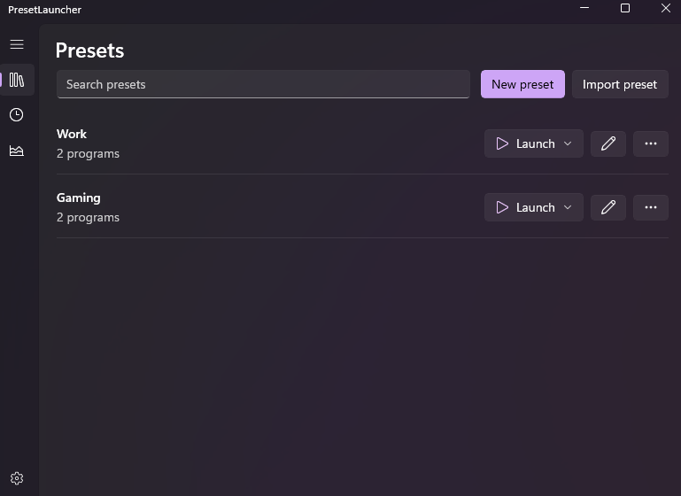

<h1 align="center">PresetLauncher</h1>

Open your Windows apps together in one click.

  <strong>English</strong> · <a href="README.fr.md">Français</a>

  
  
  

  <strong><a href="https://jimmarley420.github.io/Preset_launcher/download.html">Download for Windows</a></strong> ·
  <a href="https://jimmarley420.github.io/Preset_launcher/">Website</a> ·
  <a href="https://github.com/JimMarley420/Preset_launcher/releases">Releases</a> ·
  <a href="https://github.com/JimMarley420/Preset_launcher/issues">Issues and suggestions</a>

  

## About

PresetLauncher groups programs into presets. Create a preset for work, gaming or any routine that involves opening the same apps.

* Start every program in a preset or just the ones that aren't running.
* Add apps, shortcuts and scripts, with individual launch delays and optional administrator privileges.
* Import presets from JSON, search and filter launch history, inspect launch failures and back up application data.
* Choose between light and dark themes, in English or French.

## Installation

Download the installer for your processor from the [latest release](https://github.com/JimMarley420/Preset_launcher/releases/latest).

| Windows processor | Installer | Runtime validation |
| --- | --- | --- |
| x64 | `PresetLauncher_Setup_<version>.exe` | ✅ Tested natively |
| 32-bit x86 | `PresetLauncher_Setup_<version>_x86.exe` | ✅ Tested under WOW64 |
| ARM64 | `PresetLauncher_Setup_<version>_arm64.exe` | ⚠️ Native testing pending |

Check **Settings → System → About → System type**. Use a Microsoft-supported Windows version.

PresetLauncher checks for updates at startup and under **Settings → Check for updates**. The update screen shows the offered version and its release notes. After you select **Install update**, PresetLauncher downloads and verifies the installer, opens the normal setup wizard and closes. Complete the wizard to install the update and reopen the application. Windows may ask for administrator approval for an installation shared by all users or require a restart.

## Documentation

[User guide](docs/USAGE.md) · [Build from source](docs/DEVELOPMENT.md#build-from-source) · [Contributing](CONTRIBUTING.md) · [Security](SECURITY.md)

Built with C#, .NET and WinUI 3. Distributed under the [MIT license](LICENSE).
By Jimmy Marley
